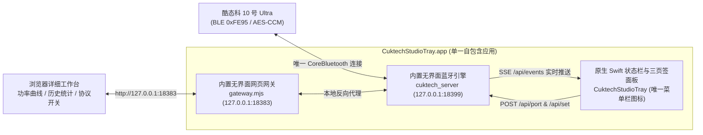

# CuktechStudioTray — 酷态科 10 号 Ultra 状态栏功率表与工作台（macOS 一体化版）

<p>
  <a href="LICENSE"></a>
  
  
  
</p>

一个面向 **酷态科 10 号超级电能充 Ultra（CUKTECH 10 GaN Charger Ultra / AD1204U）** 的 macOS 原生菜单栏工具：将 [Blank2007/cuktech-ultra-tray](https://github.com/Blank2007/cuktech-ultra-tray) 的**顶栏实时彩色功率表 + 三页签毛玻璃控制面板**，与 [morty626/cuktech-studio-releases](https://github.com/morty626/cuktech-studio-releases) 的**蓝牙守护服务 + 完整网页工作台**合并打包进**唯一一个 `.app`** 中。

* **一个应用、一个菜单栏图标**：不占程序坞（Dock），顶部状态栏只显示 **1 枚原生模板闪电图标 + 随功率五档变色的实时总功率数字**，无需额外运行第二个程序。
* **本地蓝牙直连、零连接争抢**：充电器同一时刻仅允许 1 个蓝牙主连接；本应用在 `.app` 内部以无界面（Headless）子进程托管蓝牙后端（`127.0.0.1:18399`）与网页网关（`127.0.0.1:18383`），状态栏面板通过本地 SSE 实时流秒级同步数据，两边共享同一条蓝牙链路。
* **轻重兼顾**：日常瞥一眼菜单栏读总功率，点开状态栏毛玻璃小面板看四口明细、一键单口断电或切换充电模式；想看功率曲线、历史统计或调整快充协议开关时，点一下面板右上角的「工作台」即在浏览器打开完整本地控制台。

---

## 一、核心特性

| 特性 | 说明 |
| :--- | :--- |
| ⚡ **状态栏实时彩色功率** | 菜单栏采用等宽数字字体（防跳动抖动）实时显示四口总输出，颜色按 120W 满载分五档变化，并自动适配 macOS 深色 / 浅色菜单栏对比度 |
| 🪟 **三页签毛玻璃面板** | 复刻 `cuktech-ultra-tray` 经典交互：**读数**（总输出 + `C1` / `C2` / `C3` / `USB-A` 电压、电流、功率与快充协议胶囊）、**控制**（四口独立通断开关 + 自动回读确认 + 离线防盲写）、**模式**（`AI 智能` / `数码生态` / `极速单口` / `均衡输出` 四档切换） |
| 📌 **桌面图钉与失焦收起** | 未固定时点击外部或按 `Esc` 自动收起；点击右上角图钉可常驻桌面并自动记住拖拽坐标，不强压全屏窗口 |
| 📊 **完整网页工作台联动** | 内置 `CUKTECH Studio` 网页工作台（`http://127.0.0.1:18383`），支持查看实时功率曲线、充电会话历史、电量统计及精细协议控制；若在工作台中切换局域网后端，状态栏也会自动同步跟随 |
| 📱 **内置米家扫码绑定** | 面板内置原生「米家 App 扫码导入」向导（扫码期间面板自动防失焦关闭），同时修补了内置网页端对小米新登录子域名 `ak.account.xiaomi.com` 二维码的校验兼容性 |
| 🛡️ **握手进度与防误断** | 首次连接或重连期间实时展示 `搜索充电器广播…` → `建立蓝牙连接…` → `加密认证 [1/5]~[5/5]…` 进度，并在握手期自动锁定重连按钮防止误触中断 |
| 🧹 **一体化进程生命周期** | 启动应用自动静默拉起内部蓝牙与网页子进程；菜单退出或收到 `SIGTERM` / `SIGINT` 信号时同步优雅回收全部内部子进程，不留后台孤儿进程 |

---

## 二、架构说明

酷态科 10 号 Ultra 是小米 **MIoT BLE（服务 `0xFE95`）单主设备**：实时功率不上云，也不经过米家中枢网关转发，同一时间只接受一个 BLE 客户端连接。如果菜单栏工具与网页后台各自独立连接蓝牙，必然互相踢下线。

本项目采用 **「单一 `.app` 内置无界面双引擎 + 原生 Swift 状态栏外壳」** 架构解决这一冲突：



### 功率颜色分档（对齐 `cuktech-ultra-tray`）

| 档位颜色 | 总功率范围 | 单口功率范围 | 含义 |
| :--- | :--- | :--- | :--- |
| 灰色 | 未连接 / `≤ 0.05 W` | 空闲 / `≤ 0.05 W` | 空载或待连接 |
| 淡蓝色 | `0.05 – 20 W` | `0.05 – 20 W` | 小电流 / 涓流充电 |
| 绿色 | `20 – 60 W` | `20 – 40 W` | 正常快充 |
| 琥珀黄 | `60 – 100 W` | `40 – 80 W` | 高功率输出 |
| 红色 | `≥ 100 W`（省略小数） | `≥ 80 W` | 接近满载上限 |

---

## 三、快速构建与安装

### 环境要求

* **系统**：macOS 14.0 或更高版本（Apple Silicon `arm64`）
* **编译工具**：Xcode Command Line Tools（终端运行 `xcode-select --install` 即可，无需完整 Xcode）
* **硬件前提**：充电器已通电并在蓝牙范围内，且已在手机米家 App 中绑定到你的小米账号

### 一键编译打包

```bash
git clone https://github.com/Rocoer7/cuktech-ultra-mac-tray.git
cd cuktech-ultra-mac-tray

# 编译打包到 dist/CuktechStudioTray.app，并同步安装到 ~/Applications/CuktechStudioTray.app
# （首次运行时会自动从 morty626/cuktech-studio-releases 下载官方运行库缓存至本地 .studio-runtime/）
chmod +x build_tray_app.sh
bash build_tray_app.sh --install-user
```

### 运行回归自检（可选）

```bash
./dist/CuktechStudioTray.app/Contents/MacOS/CuktechStudioTray --selftest
```

`--selftest` 会依次执行功率分档边界、MAC 校验、SSE 状态机解析、离线防盲写单元自测，以及内置双引擎拉起、健康检查、SSE 首帧接收与进程回收闭环测试。

---

## 四、首次使用三步曲

1. **启动应用**
   ```bash
   open ~/Applications/CuktechStudioTray.app
   ```
   首次启动弹出「想要使用蓝牙」系统授权提示时，请点击 **允许**（若错过弹窗，可在「系统设置 → 隐私与安全性 → 蓝牙」中开启）。
2. **米家 App 扫码导入充电器**
   * 点击 Mac 顶部菜单栏出现的闪电图标 `待绑定` → 在弹出的面板中点击 **「扫码绑定」**；
   * 打开手机 **米家 App → 右上角 `+` → 扫一扫**，扫描面板中的二维码并确认登录；
   * 在列出的充电器右侧点击 **「绑定此台」**，凭据将保存在本机 `~/Library/Application Support/CUKTECH Studio/config.yaml`。
3. **退出手机米家 App**
   * 手机米家 App 前台打开时会占用充电器唯一的蓝牙连接；划掉手机米家 App 后静候约 **20–30 秒**（面板会实时显示 `搜索充电器广播…` → `建立蓝牙连接…` → `加密认证 [1/5]~[5/5]…`），认证完成后菜单栏即开始实时显示彩色功率。

---

## 五、命令行参数与日常操作

* **左键点击菜单栏图标**：弹出 / 收起三页签迷你面板
* **右键点击菜单栏图标**（或 `Control + 左键`）：弹出快捷菜单（切换充电模式、打开网页工作台、扫码绑定、固定面板、设置随 macOS 登录自启、重连蓝牙、查看运行日志、退出）

| 启动参数 | 作用 |
| :--- | :--- |
| （无参数） | 正常启动：常驻顶部状态栏、拉起内置双引擎并弹出面板 |
| `--tray-only` | 静默驻留状态栏，不主动弹面板（开启「随 macOS 登录启动」时自动使用） |
| `--panel` | 启动并强制显示面板 |
| `--control` | 启动并直接切换到「控制（单口通断）」页签 |
| `--selftest` | 运行命令行单元自测与内置服务启停集成自测（退出码 `0` / `1`） |

---

## 六、目录结构

```text
.
├── Sources/
│   ├── main.swift               # 程序入口、单实例让位控制与 --selftest 回归自检
│   ├── AppDelegate.swift        # NSStatusItem 单图标渲染、左右键分发与右键快捷菜单
│   ├── PanelController.swift    # 无边框浮动面板窗口、桌面图钉位置记忆与失焦收起
│   ├── PanelView.swift          # SwiftUI 三页签毛玻璃面板（读数/控制/模式）与内置扫码卡片
│   ├── Smart10uStore.swift      # SSE 实时流订阅、多设备状态机、控制回读校验与握手日志追踪
│   ├── BackendSupervisor.swift  # 内置无界面蓝牙服务(18399)与网页网关(18383)进程守护及信号回收
│   ├── LaunchAgentHelper.swift  # 当前用户 LaunchAgents 登录自启管理
│   ├── Models.swift             # 端口读数、充电模式、设备快照与扫码状态定义
│   └── WattStyle.swift          # 五档功率取色（深浅色菜单栏自适应）与数值格式化
├── build_tray_app.sh            # 自动拉取运行库、修补前端扫码白名单、编译 Swift 与签名打包脚本
├── LICENSE                      # MIT 开源许可证
└── README.md
```

---

## 七、参考项目与致谢

本项目站在以下优秀开源与社区项目的肩膀上构建，特此向各位作者致谢：

1. **[Blank2007/cuktech-ultra-tray](https://github.com/Blank2007/cuktech-ultra-tray)**（MIT License）
   * **参考内容**：本项目状态栏与迷你面板交互设计的直接原型。完整参考并复刻了其 120W 五档功率配色体系、数值格式化规则、「读数 / 控制 / 模式」三页签信息架构、桌面图钉固定交互、未连接防盲写安全约束、单实例唤醒以及 `--selftest` 工程自检思路。
2. **[morty626/cuktech-studio-releases](https://github.com/morty626/cuktech-studio-releases)**（CUKTECH Studio）
   * **参考与集成内容**：提供了精致的本地网页工作台（功率曲线、历史记录、多后端网关管理）与 macOS 预构建蓝牙服务运行库。[build_tray_app.sh](build_tray_app.sh) 在本地打包时自动获取其官方 Release 包并以无界面子进程方式集成于同一 `.app` 内，同时修补了其前端对小米新登录域名 `ak.account.xiaomi.com` 二维码的兼容问题。
3. **[kairui1108/cuktech-ble-ha](https://github.com/kairui1108/cuktech-ble-ha) / [kairui1108/cuktech-ble-server](https://github.com/kairui1108/cuktech-ble-server)**（MIT License）
   * **参考内容**：酷态科 10 号 Ultra（AD1204U）底层小米 MIoT BLE（`0xFE95`）加密握手协议逆向研究、macOS `CoreBluetooth` 广播尾字节 MAC 匹配思路，以及本地 `/api/events`（SSE）、`/api/status`、`/api/port`、`/api/set` 接口契约的上游基础实现。
4. **[sdlyingyong/smart10u](https://github.com/sdlyingyong/smart10u)**（MIT License）
   * **参考内容**：参考了其在 macOS 环境下通过 `.app` Bundle 声明蓝牙用途以配合 TCC 权限、强制本地 `127.0.0.1` 请求绕过系统代理（避免代理软件劫持本地回环流量）以及防多进程争抢蓝牙连接的实践经验。
5. **[sunnyboy5/cuktech-10-ultra-monitor](https://github.com/sunnyboy5/cuktech-10-ultra-monitor)**
   * **参考内容**：参考了其在 macOS `NSPanel` 无激活悬浮窗中使用原生材质与避免弹窗焦点冲突的探索经验。

---

## 八、许可与免责声明

* 本仓库内的原生 Swift 源代码与构建脚本采用 [MIT License](LICENSE) 开源；构建期自动下载打包的 `CUKTECH Studio` 运行时及其内置第三方组件版权与许可归各自原作者所有。
* **隐私与安全**：小米扫码仅用于从你本人的小米云账号拉取充电器的本地 BLE Token 并保存在本机 `~/Library/Application Support/CUKTECH Studio/config.yaml` 中，切勿将包含个人 `mac`、`token`、`ble_key` 的配置文件上传至公开仓库或分享给他人。
* **非官方声明**：本项目为个人学习与桌面效率自用工具，与酷态科（CUKTECH）、小米（Xiaomi / 米家）官方无任何关联。控制端口开关会中断对应接口供电，请确认连接设备状态后操作。
